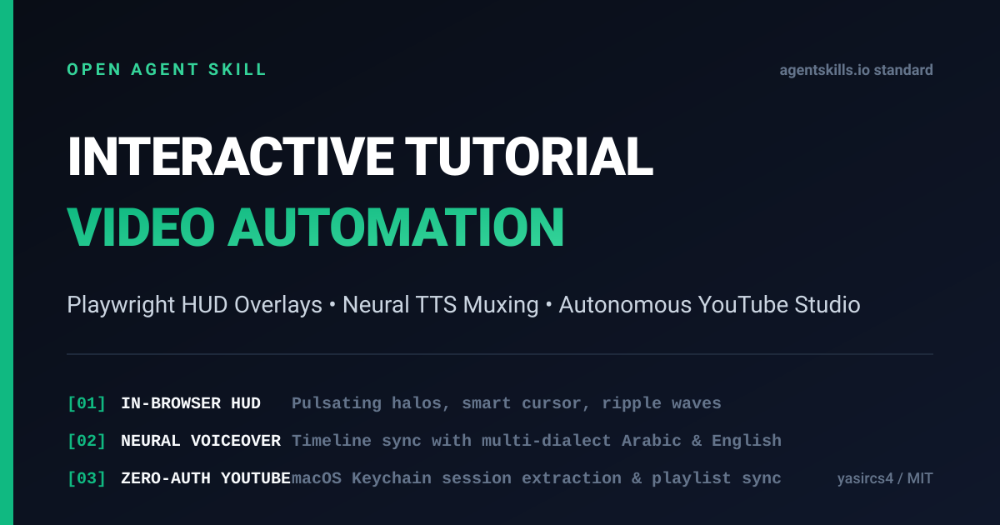

# Interactive Tutorial Video

<div align="center">
  <a href="https://raw.githubusercontent.com/yasircs4/interactive-tutorial-video/main/assets/showcase_demo.mp4">
    
  </a>
  <p>▶️ <strong><a href="https://raw.githubusercontent.com/yasircs4/interactive-tutorial-video/main/assets/showcase_demo.mp4">Watch Showcase Demo (1080p MP4)</a></strong> &nbsp;|&nbsp; 📋 <strong><a href="https://www.youtube.com/playlist?list=PLE7Mvo3W8zQY">Watch YouTube Playlist Suite</a></strong></p>
  <p><em>Full HD 1080p interactive tutorial demonstrating pulsating spotlight rings, smart virtual cursor, click ripple waves, collision-safe tooltip pills, and synchronized neural voiceovers.</em></p>
  <p>Created by <strong>Yasir Najeep</strong> (<a href="https://yasirnajeep.com/">yasirnajeep.com</a> | <a href="mailto:info@yasirnajeep.com">info@yasirnajeep.com</a>)</p>
</div>

[](https://skills.sh/yasircs4/interactive-tutorial-video)
[](LICENSE)
[](https://agentskills.io/specification)

An open Agent Skill for autonomously recording interactive Full HD tutorial videos from web applications, synchronizing localized neural voiceovers, generating automated captions, and publishing them directly to YouTube with verified playlist organization.

Built for AI coding agents (Claude Code, OpenAI Codex, Cursor, Windsurf, Trae, Roo, Qoder, and others) to transform routine software walkthroughs into engaging, high-retention video guides.

---

## Why this skill?

Automated browser recordings typically look flat: viewers struggle to locate which button was pressed or why a certain menu opened, and synthetic voices often sound unnatural or out of sync.

`interactive-tutorial-video` delivers a complete, dependable pipeline:

1. **Navigation-Safe In-Browser Visual HUD Engine:** Dynamically injects pulsing spotlight halos, a virtual vector cursor with smooth bezier curves, expanding click ripple waves, pointing tooltip pills (with collision detection and auto-flip), and frosted-glass step banners. Re-injects automatically across multi-page flows via `page.addInitScript`.
2. **Unified Timeline & Duration-Aware Narration:** Drives recording pacing directly from narration duration (`TutorialSession` / `narrate`). Prevents audio truncation by automatically holding the last video frame if speech exceeds recording duration. Generates synchronized `.srt` and `.vtt` captions and enforces broadcast EBU R128 loudness normalization (`-16 LUFS`).
3. **Universal H.264 MP4 Transcoding:** Transcodes raw Playwright WebM (VP8/VP9) into standardized, QuickTime/Safari/iOS-compatible 1080p H.264/AAC MP4.
4. **Verifiable YouTube Publishing & Playlist Management:** Supports both dedicated Playwright profiles/storageState and macOS Keychain session extraction (Node 18+ compatible). Verifies actual publication IDs, maintains an upload ledger to prevent duplicates, and organizes videos into unlisted playlists.
5. **Mobile 9:16 Shorts Generator:** Converts 16:9 tutorial videos into vertical 9:16 (1080x1920) YouTube Shorts, TikToks, and Instagram Reels with blurred motion background and glassmorphism badges.

---

## Live Case Study: Taiba Store (Soluq, Libya)

This pipeline was used in production to produce and deliver a complete 5-video training suite for an Odoo point-of-sale deployment in Soluq, Libya. All videos were recorded in 1080p, voiced in Libyan Arabic (`ar-LY-ImanNeural`), and automatically uploaded to an unlisted playlist:

- **Unlisted YouTube Playlist:** [Watch on YouTube](https://www.youtube.com/playlist?list=PLE7Mvo3W8zQY)
- **Included Guides:**
  1. Point of Sale & Invoicing (`https://youtu.be/DU6fOkoATzk`)
  2. Adding Products & Barcodes (`https://youtu.be/tCemwfTTW6s`)
  3. Daily Sales Reports & Inventory (`https://youtu.be/EeWSkUK_YKg`)
  4. Cash Drawer Closing & Expenses (`https://youtu.be/NEKC6iaiQtU`)
  5. Returns & Exchanges (`https://youtu.be/C2gSl_7LVdE`)

---

## Installation

### Install globally for all agents

```bash
npx skills add yasircs4/interactive-tutorial-video -g -a '*' -y
```

### Install for specific agents

For Codex:
```bash
npx skills add yasircs4/interactive-tutorial-video -g -a codex -y
```

For Claude Code:
```bash
npx skills add yasircs4/interactive-tutorial-video -g -a claude-code -y
```

For Cursor, Windsurf, Trae, and others:
```bash
npx skills add yasircs4/interactive-tutorial-video -g -a cursor -y
```

---

## Environment Verification

Run the built-in doctor utility to verify Node.js, Python, FFmpeg, edge-tts, Playwright, and disk space:

```bash
npm run doctor
```

---

## Quick Start

### 1. In-Browser Recording with Navigation-Safe Overlays

```javascript
import { chromium } from "playwright";
import {
  setupInteractiveEngine,
  highlight,
  highlightAndClick,
  typeWithFocus,
  showBanner,
  zoomTo,
  TutorialSession
} from "./skills/interactive-tutorial-video/scripts/tutorial_engine.js";
import { convertToH264 } from "./skills/interactive-tutorial-video/scripts/convert_video.js";

const browser = await chromium.launch({ headless: true });
const context = await browser.newContext({
  recordVideo: { dir: "./output/videos", size: { width: 1920, height: 1080 } },
  viewport: { width: 1920, height: 1080 }
});
const page = await context.newPage();
await page.goto("http://localhost:3000/pos");

const session = new TutorialSession(page, { accentColor: "#10b981" });
await session.start();

// Narration automatically controls banner and pacing
await session.narrate("Step one: Select a product to add it to customer ticket.", {
  banner: { badge: "Step 1", title: "Select Product", subtitle: "Click on any product card" }
});

// Target is automatically scrolled into view before measurement with optional verification
await highlightAndClick(page, ".product-card:first-child", {
  label: "Wireless Headphones",
  verify: "#pos-cart-badge"
});

// Selective zoom into dense UI elements
await zoomTo(page, "input#discount-input", 1.5);

const videoPath = await page.video().path();
await context.close();
await browser.close();

// Transcode to standardized H.264 1080p MP4 (30 fps, Stereo AAC)
convertToH264(videoPath, "./output/videos/tutorial.mp4");
```

### 2. Synthesize & Mux Synchronized Voiceover with Captions

```bash
python3 ./skills/interactive-tutorial-video/scripts/mux_voiceover.py \
  --video ./output/videos/tutorial.mp4 \
  --manifest ./output/videos/demo_timeline.json \
  --output ./output/videos/tutorial_voiced.mp4 \
  --voice "ar-LY-ImanNeural" \
  --export-captions
```

### 3. Verify Broadcast Quality (EBU R128 Loudness & Codecs)

```bash
npm run quality-report -- --video ./output/videos/tutorial_voiced.mp4
```

### 4. Create 9:16 Vertical Short (YouTube Shorts / Reels)

```bash
npm run build:shorts -- ./output/videos/tutorial_voiced.mp4 ./output/videos/short.mp4 --title "POS Tutorial"
```

### 5. Publish to YouTube Studio & Organize Playlist

```bash
node ./skills/interactive-tutorial-video/scripts/youtube_session_uploader.js upload_plan.json
```

---

## Technical Architecture

```text
+-----------------------------------------------------------------------------------+
| 1. RECORDING PHASE (Playwright + page.addInitScript DOM Overlay Injection)         |
|    - Dynamic accent glow calculation (hex/rgb to rgba tokens)                     |
|    - Smart Virtual Cursor follows actions smoothly via cubic-bezier transitions   |
|    - Scroll-before-measurement prevents off-screen misplaced highlights          |
|    - Collision detection automatically flips tooltips near screen edges           |
|    - Responsive HUD banners stay within mobile (390px) and desktop boundaries     |
|    - Output: Raw 1080p WebM recording + timeline manifest                         |
+-----------------------------------------------------------------------------------+
                                       |
                                       v
+-----------------------------------------------------------------------------------+
| 2. AUDIO SYNTHESIS & TIMELINE MUXING (edge-tts + ffmpeg)                          |
|    - Synthesize discrete voice segments (Libyan, Saudi, Egyptian, US/UK English)  |
|    - Transcode VP8/VP9 WebM to universal H.264 MP4 (yuv420p, +faststart)         |
|    - Duration guard: holds final video frame if narration exceeds recording time  |
|    - Apply EBU R128 loudness normalization (-16 LUFS) & AAC audio encoding        |
|    - Export synchronized WebVTT & SubRip (.srt) caption files                     |
+-----------------------------------------------------------------------------------+
                                       |
                                       v
+-----------------------------------------------------------------------------------+
| 3. AUTONOMOUS YOUTUBE STUDIO DISTRIBUTION (Playwright + Profile / Keychain)       |
|    - Supports Playwright storageState or macOS Chrome/Brave cookie extraction     |
|    - Universal SQLite support across Node 18, 20, 22, 24+ (built-in fallback)     |
|    - SHA-256 upload ledger prevents accidental re-uploads                         |
|    - Automated playlist creation and membership verification                      |
|    - Confirms published video ID via provider readback before exit                |
+-----------------------------------------------------------------------------------+
```

---

## Quality Checklist for Produced Tutorials

- **Resolution:** Full HD 1080p (1920x1080 horizontal or 1080x1920 vertical).
- **Video Codec:** H.264 (`yuv420p`, high profile, `+faststart` web-optimized).
- **Audio:** AAC 192kbps (mono or stereo), normalized to EBU R128 target (`-16 LUFS`).
- **Pacing:** Minimum 1000ms pause after major transitions; narration drives timing.
- **Safety:** Tooltips automatically reposition if placed in top 70px; HTML labels escaped against XSS.
- **Deduplication:** Upload ledger records file hashes to guarantee idempotent runs.

---

## Project Structure

```text
interactive-tutorial-video/
├── .github/
│   └── workflows/
│       └── ci.yml
├── README.md
├── LICENSE
├── CONTRIBUTING.md
├── package.json
├── SKILL.md
├── skills/
│   └── interactive-tutorial-video/
│       ├── SKILL.md
│       ├── agents/
│       │   └── openai.yaml
│       └── scripts/
│           ├── tutorial_engine.js
│           ├── mux_voiceover.py
│           ├── youtube_session_uploader.js
│           ├── convert_video.js
│           ├── build_shorts.js
│           ├── build_shorts.py
│           ├── multilingual_generator.py
│           ├── doctor.js
│           └── quality_report.py
├── tests/
│   ├── tutorial_engine.test.js
│   ├── test_mux_voiceover.py
│   ├── test_quality_report.py
│   ├── uploader.test.js
│   └── doctor.test.js
└── examples/
    ├── full_tutorial_flow.js
    ├── manifest_example.json
    ├── prompts.md
    └── fixture/
        └── demo_app.html
```

---

## Author & License

Created by **Yasir Najeep** ([yasirnajeep.com](https://yasirnajeep.com/) | [info@yasirnajeep.com](mailto:info@yasirnajeep.com)).

Distributed under the **MIT License**. See [LICENSE](LICENSE) for details.
